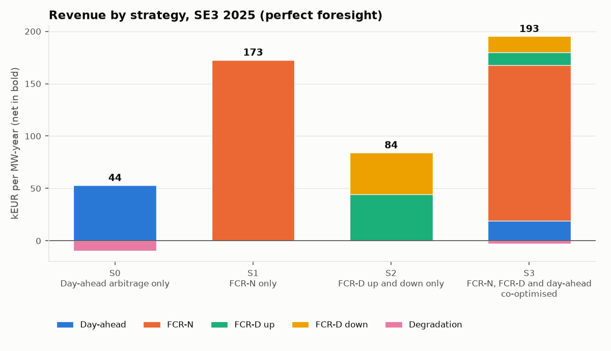
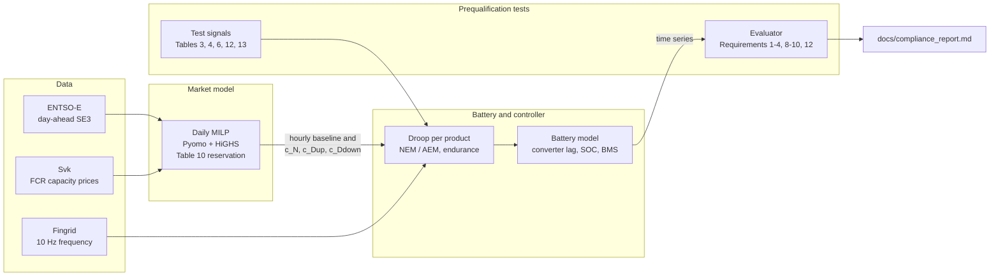
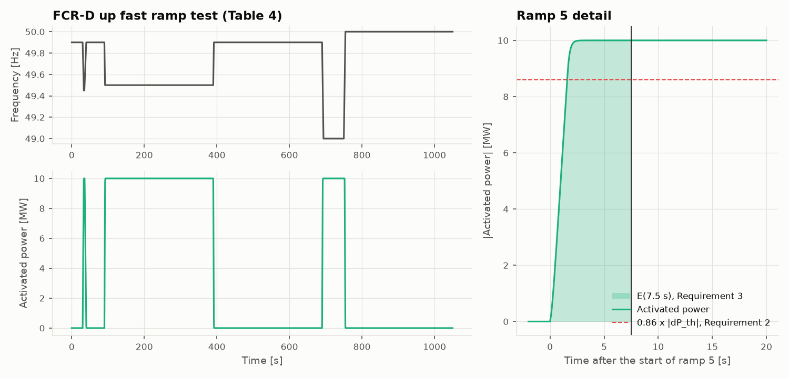
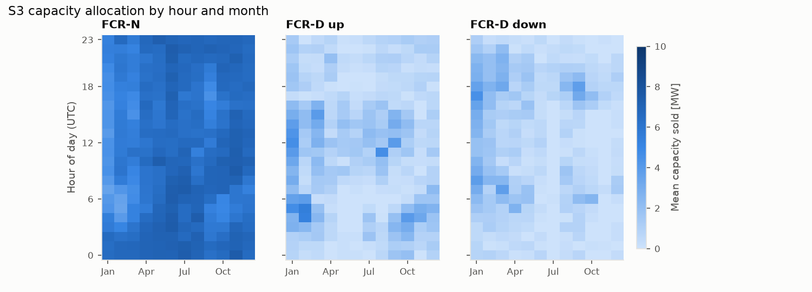
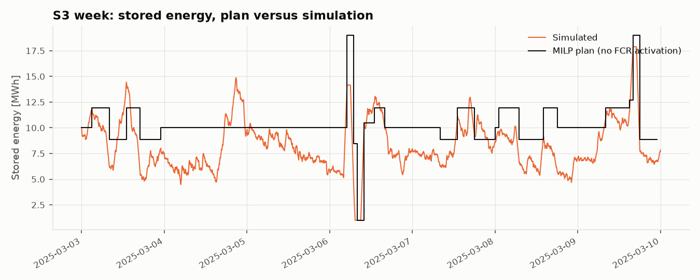
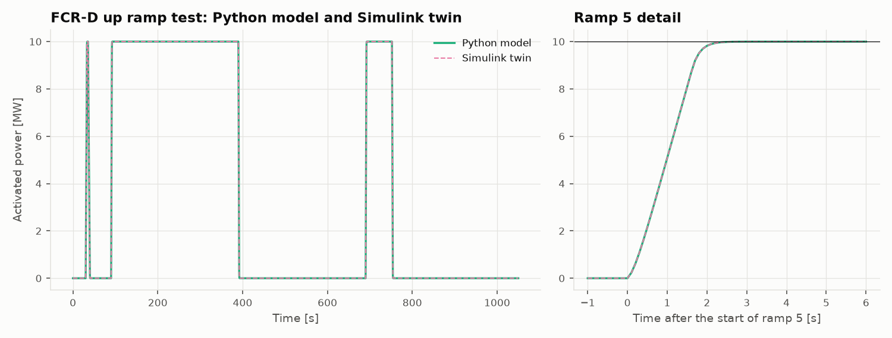
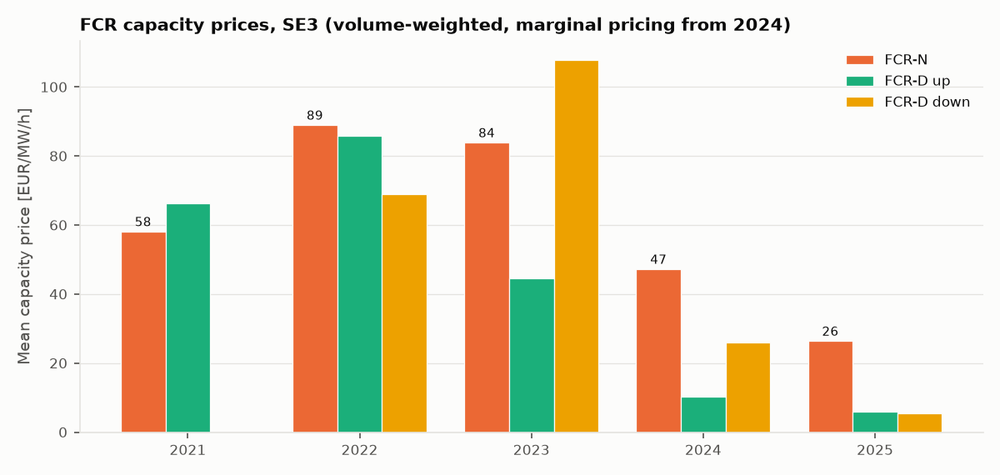

# nordic-bess-fcr

Bidding, control and prequalification testing for a 10 MW / 20 MWh battery in the
Swedish SE3 zone, using 2025 market and grid-frequency data and the Nordic TSOs' FCR
technical requirements (v1.1).



With perfect foresight, selling FCR-N and FCR-D capacity and trading day-ahead energy
together would have earned about 193 kEUR per MW in 2025, compared with 44 kEUR from
day-ahead arbitrage alone. Bidding on simple forecasts instead gives 163-169 kEUR. In
simulation the battery controller passes the 24 prequalification checks evaluated here,
including the energy-management tests for limited energy reservoirs, and a Simulink
version of the controller gives the same results.

There is a one-page business summary in [docs/EXECUTIVE_SUMMARY.md](docs/EXECUTIVE_SUMMARY.md).

## Background

A battery owner in the Nordic market decides every day how much capacity to sell as
frequency containment reserve (FCR-N, FCR-D up, FCR-D down) and how much to keep for
day-ahead trading. Once the capacity is sold, the battery has to deliver it second by
second without running out of energy. The rules are in the TSOs' *Technical Requirements
for Frequency Containment Reserve Provision in the Nordic Synchronous Area* (v1.1, in
force since 2 June 2025). Table 10 sets how much power and energy a limited energy
reservoir (LER) must hold back for each MW it sells, section 3.5 describes how it manages
its state of charge (Normal and Alert State Energy Management, NEM and AEM), and the
prequalification tests decide whether it may sell at all.

This repository follows one battery through those steps, using ENTSO-E day-ahead prices,
Svenska kraftnät FCR capacity prices and Fingrid 10 Hz frequency measurements.

## How it works



| Part | Code | Script | Output |
| --- | --- | --- | --- |
| Data | `src/nordic_bess/data/` | `scripts/fetch_data.py` | `data/processed/*.parquet`, [docs/DATA.md](docs/DATA.md) |
| Market model | `src/nordic_bess/market/` | `scripts/run_backtest.py` | `results/revenue_summary.csv` |
| Battery and controller | `control/`, `plant/`, `sim/` | `scripts/run_simulation.py` | `results/simulation_kpis.csv` |
| Prequalification tests | `src/nordic_bess/compliance/` | `scripts/run_compliance.py` | [docs/compliance_report.md](docs/compliance_report.md) |
| Simulink twin | `simulink/` (MATLAB, Simscape Electrical) | `simulink/run_twin.m`, `scripts/evaluate_twin.py` | [docs/twin_report.md](docs/twin_report.md) |

### The market model

Each UTC day is one mixed-integer linear program (Pyomo with HiGHS), solved with hourly
prices as a price taker. The decisions are the day-ahead charge and discharge power and
the FCR-N, FCR-D up and FCR-D down capacity sold in each hour. The objective is day-ahead
revenue plus capacity payments minus a degradation cost of 10 EUR per MWh discharged.

The FCR rules enter as headroom constraints taken from Table 10:

```text
upward power:    p_d - p_c + 1.34 c_N + c_Dup + 0.20 c_Ddown <= P_max
downward power:  p_d - p_c - 1.34 c_N - 0.20 c_Dup - c_Ddown >= -P_max
upward energy:   eta_d (e - E_min) >= 1 h * c_N + 1/3 h * c_Dup     (start and end of each hour)
downward energy: (E_max - e) / eta_c >= 1 h * c_N + 1/3 h * c_Ddown (start and end of each hour)
```

The factor 1.34 is full FCR-N activation plus the 0.34 NEM rate, and 0.20 is the FCR-D
NEM rate, which acts in the opposite direction. Every day starts and ends at 50 % of the
usable energy. The strategies S0-S3 below are the same model with some products fixed to
zero. The full formulation is in
[src/nordic_bess/market/milp.py](src/nordic_bess/market/milp.py), and every solved day is
checked against the constraints again outside the model.

## Results

### Revenue by strategy in 2025

<!-- BEGIN revenue -->
| Strategy | Day-ahead | FCR-N | FCR-D up | FCR-D down | Degradation | Net | Cycles / yr |
| --- | ---: | ---: | ---: | ---: | ---: | ---: | ---: |
| S0 Day-ahead arbitrage only | 53.1 | 0.0 | 0.0 | 0.0 | -9.4 | 43.7 | 520 |
| S1 FCR-N only | 0.0 | 172.8 | 0.0 | 0.0 | 0.0 | 172.8 | 0 |
| S2 FCR-D up and down only | 0.0 | 0.0 | 44.3 | 39.9 | 0.0 | 84.3 | 0 |
| S3 FCR-N, FCR-D and day-ahead co-optimised | 19.2 | 148.5 | 11.9 | 15.7 | -2.7 | 192.7 | 148 |

kEUR per MW-year, SE3, 2025. Net is the sum of the other columns.
<!-- END revenue -->

Most of the money comes from FCR-N. Its capacity price averaged 26.4 EUR/MW/h in 2025,
more than four times FCR-D, so selling FCR-N alone (S1) already reaches 90 % of the
co-optimised result (S3). Co-optimisation adds FCR-D and arbitrage in the hours when
FCR-N is cheap. The Table 10 power reservation binds in about 94 % of the hours and the
energy reservation in about a quarter of them.

### Forecasts, 15-minute prices and rule changes

<!-- BEGIN market_cases -->
| Case | Net kEUR / MW-yr | Change vs reference | Cycles / yr |
| --- | ---: | ---: | ---: |
| S3 perfect foresight (hourly, total FCR prices) | 192.7 | reference | 148 |
| S3 sequential: FCR bids on forecast, DA perfect | 163.3 | -29.4 | 140 |
| S3 sequential: FCR and DA on forecast | 163.2 | -29.5 | 145 |
| S3 stochastic: FCR bids on 4 past-week scenarios, DA perfect | 168.5 | -24.1 | 92 |
| S3 perfect foresight, 15-min day-ahead | 192.9 | +0.3 | 151 |
| S3 perfect foresight, FCR prices of fcrAuction1 only | 190.0 | -2.7 | 129 |
| S3 perfect foresight, FCR prices of fcrAuction2 only | 239.7 | +47.1 | 257 |
| S3 perfect foresight, FCR-N energy reservation 1.5 h | 168.5 | -24.2 | 176 |
<!-- END market_cases -->

Bidding FCR on a naive forecast (the same hour one week earlier) loses about 15 % of the
perfect-foresight revenue. Nearly all of that loss comes from the FCR decision: once the
capacity is sold there is little headroom left for arbitrage, so forecasting day-ahead
prices as well changes almost nothing. A two-stage stochastic model that uses the past
four weeks as scenarios recovers about a fifth of the loss and cycles the battery less.
The switch to 15-minute day-ahead prices in October 2025 adds almost nothing to an
FCR-led strategy.

Svenska kraftnät publishes two auction rounds and no combined price, so the reference
case uses the volume-weighted mean of both. Pricing all capacity at the thin second round
would overstate revenue by 47 kEUR per MW-year. The last row tests a possible rule
change: if FCR-N needs 1.5 h of energy per direction instead of 1 h, revenue falls by
24 kEUR per MW-year.

### Prequalification tests on the battery model

<!-- BEGIN compliance -->
All 24 checks pass. They cover Requirements 1, 2, 3, 4, 8, 9, 10 and 12, each for the products it applies to. The measured value and limit of every check, and a figure for every test, are in [docs/compliance_report.md](docs/compliance_report.md).
<!-- END compliance -->

The tested capacities are 7.46 MW of FCR-N, the most a 10 MW unit can sell under
Table 10, and 10 MW of each FCR-D product. Each product is tested on its own, starting
from the target state of charge. The figure shows the FCR-D up ramp test with the 7.5 s
limits of Requirements 2 and 3.



### One week on measured frequency

<!-- BEGIN simulation -->
| KPI | Value |
| --- | --- |
| Simulated period | 7 days at 1 s, schedule S3 |
| FCR unavailable | 0.0 min |
| Time with NEM active (FCR-N) | 2.3 % |
| Minimum endurance FCR-N / FCR-D up / FCR-D down | 30 / 36 / 108 min |
| Energy at start / end | 10.0 / 7.8 MWh |
| Day-ahead delivery shortfall (BMS limit) | 4.6 MWh in 39 min |
| Equivalent full cycles | 9.4 |
| Energy balance error | 0.0e+00 MWh |
<!-- END simulation -->

The S3 schedule was run at 1 s resolution on Fingrid frequency for the week starting
3 March 2025. Every sold product stayed available all week, but the stored energy drifted
away from the plan, because the MILP starts each day at 50 % and ignores activation
energy and losses. On 6 March a planned day-ahead discharge ran into an empty battery and
4.6 MWh were not delivered. Re-planning from the measured state of charge would avoid
this.

### More results

<table>
<tr>
<td width="50%"><br>Mean capacity sold under S3 by hour of day and month. FCR-N takes most of the power in almost every hour, and FCR-D fills in where FCR-N pays less, more often early in the year.</td>
<td width="50%"><br>Stored energy in the plan and in the simulation for the week of 3 March 2025. The simulated energy drifts below the plan, and on 6 March the battery runs empty during a planned discharge.</td>
</tr>
<tr>
<td><br>The Simulink twin, with a Simscape Electrical battery, against the Python model on the FCR-D up ramp test: RMSE 1.7e-6 MW and the same pass/fail on every requirement. Both run the same controller equations at a 0.1 s step, so the match mainly shows that the MATLAB port is faithful (<a href="docs/twin_report.md">twin report</a>).</td>
<td><br>FCR capacity prices in SE3 since 2021. As batteries entered the market, FCR-N fell from 89 EUR/MW/h in 2022 to 26 in 2025 and FCR-D up from 86 to 6. Before 2024 Svenska kraftnät published average prices, so those years are only indicative.</td>
</tr>
</table>

## Running it

```powershell
uv sync
uv run python scripts/fetch_data.py --config configs/base.yaml   # needs ENTSOE_API_KEY in .env
uv run python scripts/run_backtest.py --config configs/base.yaml
uv run python scripts/run_simulation.py --config configs/base.yaml
uv run python scripts/run_compliance.py --config configs/base.yaml
```

The tests (`uv run pytest -q`) only use the small extracts in `data/sample/`, so they
need no network access or API key. CI runs them on every push. Other scripts:

- `run_market_cases.py`: the forecast, stochastic, price-series and rule-change cases
- `market_context.py`: FCR price history since 2021
- `update_readme.py`: refreshes the tables in this README from `results/`
- `export_twin_inputs.py` and `evaluate_twin.py`: run before and after
  `simulink/run_twin.m` (needs MATLAB R2025a with Simscape Electrical)

## Assumptions and limitations

The ones that matter most for the results:

- The reference case has perfect foresight, so its revenue is an upper bound. The
  forecast cases use a naive same-hour-last-week forecast.
- Each day is planned on its own from 50 % of the usable energy, and the plan ignores FCR
  activation energy. Together with losses, this is why the simulated state of charge
  drifts away from the plan.
- The market model is hourly. The 15-minute day-ahead prices from October 2025 are
  averaged, except in the case that tests them.
- The battery has constant efficiency (90 % round trip), a first-order converter lag and
  no capacity fade. Degradation is a linear cost of 10 EUR per MWh discharged.
- The prequalification tests are simulations, without measurement noise or the frequency
  measurement equipment. Requirements 1b, 5-7, 11 and 13 are not evaluated.

The full list, with my reading of the parts of the FCR requirements that leave room for
interpretation, is in [docs/assumptions.md](docs/assumptions.md).

## Next steps

- Re-plan from the measured state of charge, so the market model and the battery
  simulation form a closed loop.
- Replace the naive forecast with a real price forecast.
- Evaluate Requirement 1b for combined FCR-N and FCR-D provision.

## References

- Energinet, Fingrid, Statnett and Svenska kraftnät, *Technical Requirements for
  Frequency Containment Reserve Provision in the Nordic Synchronous Area*, version 1.1,
  28 March 2025.
- Data: ENTSO-E Transparency Platform (day-ahead prices); Svenska kraftnät data portal,
  "FCR Capacity Market" (CC BY 4.0); Fingrid open data, dataset 339 "Frequency -
  historical data" (CC BY 4.0). Details in [docs/DATA.md](docs/DATA.md).

## Licence

MIT
