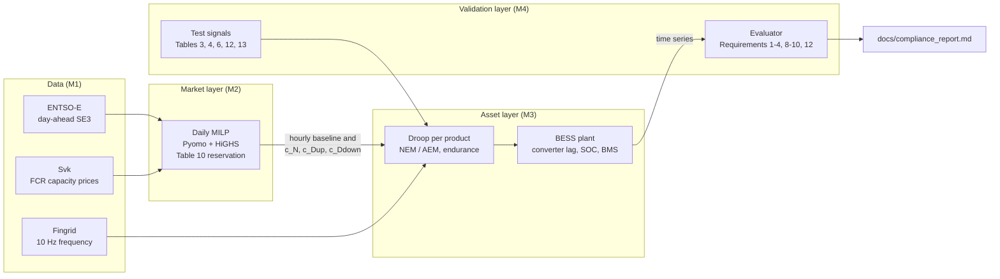

# nordic-bess-fcr

**A 10 MW / 20 MWh battery in SE3, from market decision to real-time control, checked
against the Nordic FCR prequalification requirements (v1.1).**


In 2025 the battery would have earned about **193 kEUR per MW-year** by co-optimising
FCR-N, FCR-D and day-ahead arbitrage (perfect foresight), against 44 kEUR from
arbitrage alone. Its controller passes **all 24 prequalification checks** of the FCR
technical requirements v1.1 in simulation, including the limited-energy-reservoir tests.

## The problem

A battery owner in the Nordic market has to decide every day how to split capacity
between frequency containment reserves (FCR-N, FCR-D up, FCR-D down) and day-ahead
arbitrage, and then deliver that promise second by second without running out of energy.
The rules are set by the Nordic TSOs' *Technical Requirements for Frequency Containment
Reserve Provision* (v1.1, in force since 2 June 2025): how much power and energy a
limited energy reservoir (LER) must hold back per MW sold (Table 10), how it must manage
its state of charge (NEM/AEM, section 3.5) and which tests it must pass to prequalify.

This repository follows one battery through the whole chain with real 2025 data:
ENTSO-E day-ahead prices, Svenska kraftnat FCR capacity prices and Fingrid 10 Hz grid
frequency.

## Architecture



| Layer | Code | Script | Output |
|---|---|---|---|
| Data | `src/nordic_bess/data/` | `scripts/fetch_data.py` | `data/processed/*.parquet`, [docs/DATA.md](docs/DATA.md) |
| Market | `src/nordic_bess/market/` | `scripts/run_backtest.py` | `results/revenue_summary.csv` |
| Asset | `control/`, `plant/`, `sim/` | `scripts/run_simulation.py` | `results/simulation_kpis.csv` |
| Validation | `src/nordic_bess/compliance/` | `scripts/run_compliance.py` | [docs/compliance_report.md](docs/compliance_report.md) |

## Results

### Market: revenue by strategy (2025 backtest)

<!-- BEGIN revenue -->
| Strategy | Day-ahead | FCR-N | FCR-D up | FCR-D down | Degradation | **Net** | Cycles / yr |
|---|---:|---:|---:|---:|---:|---:|---:|
| S0 Day-ahead arbitrage only | 53.1 | 0.0 | 0.0 | 0.0 | -9.4 | **43.7** | 520 |
| S1 FCR-N only | 0.0 | 172.8 | 0.0 | 0.0 | 0.0 | **172.8** | 0 |
| S2 FCR-D up and down only | 0.0 | 0.0 | 44.3 | 39.9 | 0.0 | **84.3** | 0 |
| S3 FCR-N, FCR-D and day-ahead co-optimised | 19.2 | 148.5 | 11.9 | 15.7 | -2.7 | **192.7** | 148 |

kEUR per MW-year (net = sum of the streams), SE3, 2025.
<!-- END revenue -->

FCR-N is the anchor product: its 2025 capacity price (26.4 EUR/MW/h on average) pays
more than four times FCR-D, so S1 already earns 90 % of S3. Co-optimisation adds
FCR-D and arbitrage in the hours where FCR-N is cheap. The power reservation of Table 10
is binding in about 94 % of the hours; the energy reservation in about a quarter of them.


### Market realism (M2b): forecasts, 15-minute prices, price series

<!-- BEGIN m2b -->
| Case | Net kEUR / MW-yr | Change vs reference | Cycles / yr |
|---|---:|---:|---:|
| S3 perfect foresight (hourly, total FCR prices) | 192.7 | reference | 148 |
| S3 sequential: FCR bids on forecast, DA perfect | 163.3 | -29.4 | 140 |
| S3 sequential: FCR and DA on forecast | 163.2 | -29.5 | 145 |
| S3 perfect foresight, 15-min day-ahead | 192.9 | +0.3 | 151 |
| S3 perfect foresight, FCR prices of fcrAuction1 only | 190.0 | -2.7 | 129 |
| S3 perfect foresight, FCR prices of fcrAuction2 only | 239.7 | +47.1 | 257 |
<!-- END m2b -->

Deciding FCR bids on a naive "same hour last week" forecast costs about 15 % of the
perfect-foresight revenue; almost all of that loss comes from the FCR decision, because
little headroom is left for arbitrage once capacity is sold. 15-minute day-ahead prices
(from October 2025) add almost nothing to an FCR-led strategy. Using only the thin
second auction round would overstate revenue through its price spikes, which is why the
volume-weighted series is the reference.

### Compliance: prequalification tests on the BESS model

<!-- BEGIN compliance -->
| Requirement | FCR-N | FCR-D up | FCR-D down |
|---|---|---|---|
| R1 up | PASS (0.00; [-0.05, 0.2]) | - | - |
| R1 down | PASS (-0.00; [-0.2, 0.05]) | - | - |
| R1 | - | PASS (-0.00; [-0.05, 0.2]) | PASS (0.00; [-0.2, 0.05]) |
| R2 | - | PASS (1.00; >= 0.86) | PASS (1.00; >= 0.86) |
| R2 hold | - | PASS (0.00; <= 0.01) | PASS (0.00; <= 0.01) |
| R3 | - | PASS (6.51 s; >= 3.2 s) | PASS (6.51 s; >= 3.2 s) |
| R4 | - | PASS (1.16 s; <= 2.5 s) | PASS (1.16 s; <= 2.5 s) |
| R8 | PASS (2.19; > 0.4085 (0.43 x 0.95)) | PASS (1.54; > 0.4085 (0.43 x 0.95)) | PASS (1.54; > 0.4085 (0.43 x 0.95)) |
| R9 | PASS (0.50; < 1) | PASS (0.13; < 1) | PASS (0.13; < 1) |
| R10 | PASS (0.00; < 1) | PASS (0.00; < 1) | PASS (0.00; < 1) |
| R12 (LER) | PASS (12; 12 steps) | PASS (5; 5 steps) | PASS (5; 5 steps) |

**24 of 24 checks pass.** Details and figures: [docs/compliance_report.md](docs/compliance_report.md).
<!-- END compliance -->


### Asset: one measured week with the S3 schedule

<!-- BEGIN simulation -->
| KPI | Value |
|---|---|
| Simulated period | 7 days at 1 s, schedule S3 |
| FCR unavailable | 0.0 min |
| Time with NEM active (FCR-N) | 2.3 % |
| Minimum endurance FCR-N / FCR-D up / FCR-D down | 30 / 36 / 108 min |
| Energy at start / end | 10.0 / 7.8 MWh |
| Day-ahead delivery shortfall (BMS limit) | 4.6 MWh in 39 min |
| Equivalent full cycles | 9.4 |
| Energy balance error | 0.0e+00 MWh |
<!-- END simulation -->

The controller keeps every sold product available, but the stored energy drifts away
from the plan, because the MILP plans each day from a 50 % SOC and ignores activation
energy and losses. On 2025-03-06 a planned day-ahead discharge meets an empty battery.
The next step is to close that loop (re-plan from the measured SOC).


## Reproduce in 5 commands

```powershell
uv sync                                                          # Python 3.12 environment
uv run python scripts/fetch_data.py --config configs/base.yaml   # needs ENTSOE_API_KEY in .env
uv run python scripts/run_backtest.py --config configs/base.yaml
uv run python scripts/run_simulation.py --config configs/base.yaml
uv run python scripts/run_compliance.py --config configs/base.yaml
```

`uv run pytest -q` runs the test suite on the committed samples in `data/sample/`
(no network, no keys); CI does the same on every push. `scripts/update_readme.py`
refreshes the tables above from `results/`.

## Assumptions and limitations

### Market layer

- Price taker with **perfect foresight** in the reference case: an upper bound on revenue.
  M2b replaces it with naive same-hour-last-week forecasts; no forecasting model beyond
  that is attempted.
- FCR prices: Svk publishes two procurement rounds (D-2, D-1) and no "Total" series; the
  model uses their volume-weighted mean ([docs/DATA.md](docs/DATA.md)).
- Daily horizon on **UTC days**, each starting and ending at 50 % SOC; FCR activation
  energy, its settlement and the imbalance it causes are not part of the plan.
- Hourly day-ahead resolution in the reference case (the 15-minute prices since
  2025-10-01 are averaged; M2b runs them natively). In the sequential cases every
  capacity offered is accepted at the clearing price (bids at 0 EUR/MW/h).

### Asset layer

- Constant charge and discharge efficiency (0.9487 each), no auxiliary load, no capacity
  fade; degradation as a linear cost of 10 EUR per MWh discharged.
- The converter is a first-order lag of 0.2 s; the frequency measurement is ideal.
- Table 11 thresholds are used as printed; the TSOs allow moving the disable thresholds
  for reservoirs larger than the minimum, which would let NEM restore 50 % SOC.
- With several products, the FCR-D energy reserves sit at the edges of the usable range
  and the FCR-N thresholds are shifted inwards (our reading of section 3.5).
- One week of measured frequency (March 2025) is simulated.

### Validation layer

- A simulation, not a field test: no measurement noise, no ambient or load dependence;
  the test signal is applied to the controller input, so no frequency measurement
  equipment transfer function is included (section 4.4).
- The steady-state power of a hold is the mean of its last 60 s; "small damped
  oscillations" after 7.5 s are implemented as a 1 % tolerance.
- Not evaluated: Requirement 1b (FCR-N and FCR-D combination), 5-7 and 11 (static
  FCR-D), 13 (mode shifting: not used by a battery).
- Requirement 8 uses G0 = F G (eq. 10); the requirement box prints -F G, and the reasons
  for the choice are documented in [docs/FCR_SPEC_NOTES.md](docs/FCR_SPEC_NOTES.md).

## Roadmap

See [docs/PLAN.md](docs/PLAN.md). Next: sequential bidding with forecasts and 15-minute
day-ahead prices (M2b), a Simulink digital twin evaluated with the same Python evaluator
(M5) and an executive summary (M6).

## References

- ENTSO-E et al., *Technical Requirements for Frequency Containment Reserve Provision in
  the Nordic Synchronous Area*, v1.1, 28 March 2025 (Energinet, Fingrid, Statnett,
  Svenska kraftnat).
- Data: ENTSO-E Transparency Platform; Svenska kraftnat data portal, "FCR Capacity
  Market" (CC BY 4.0); Fingrid open data, dataset 339 "Frequency - historical data"
  (CC BY 4.0).

## Licence

MIT
