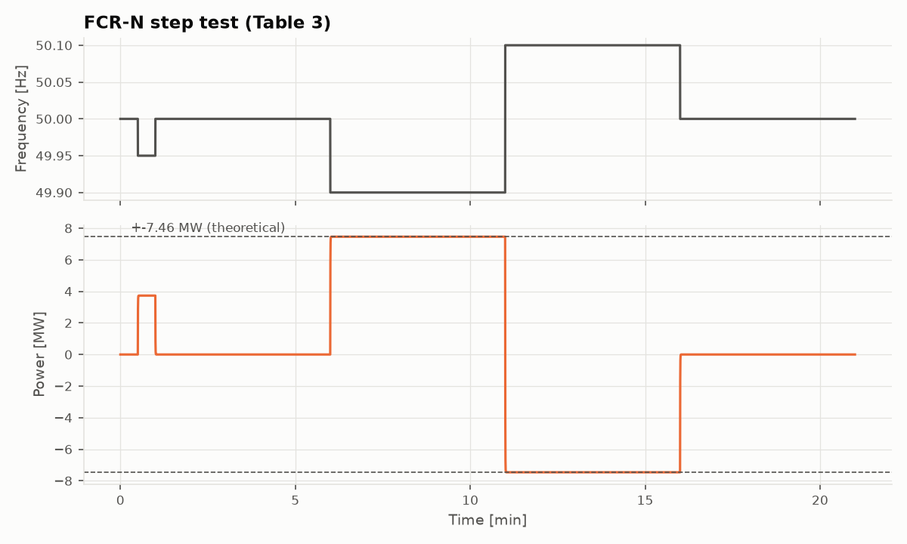
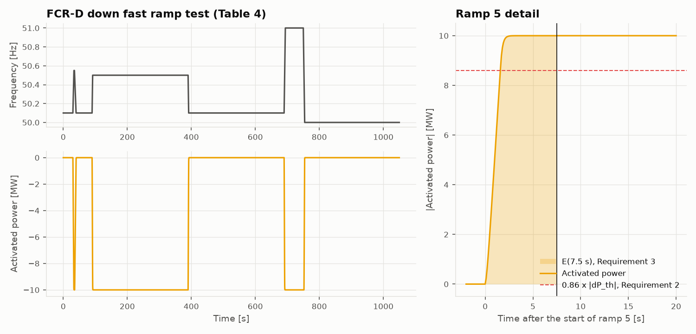
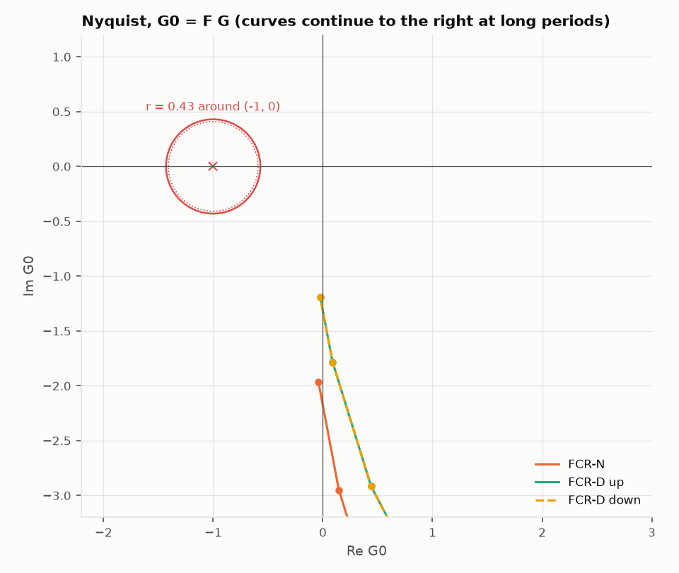
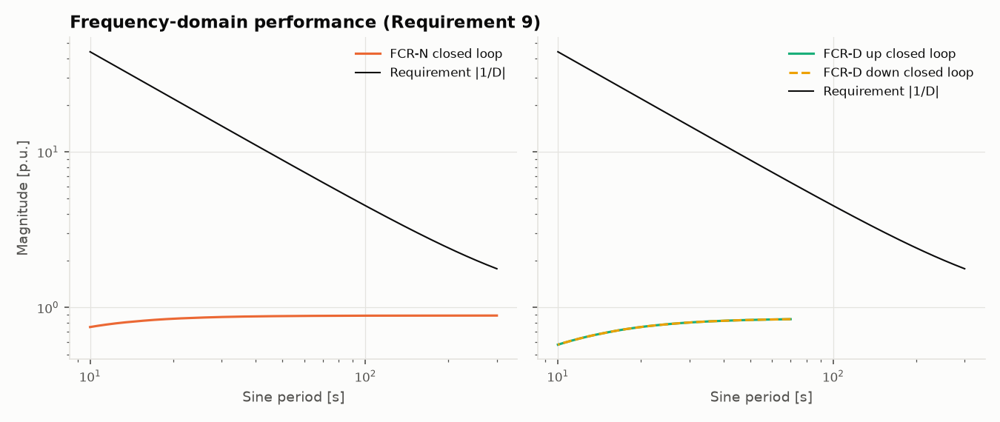
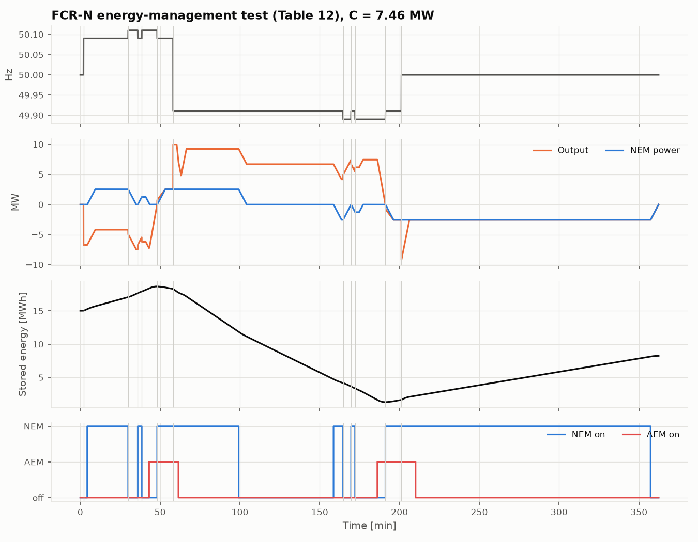
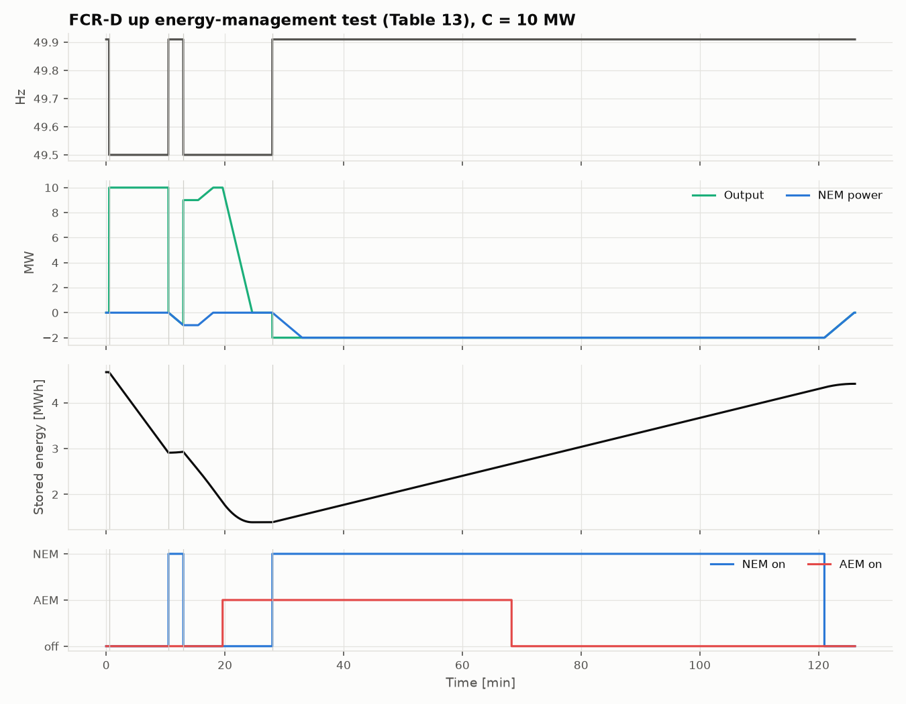
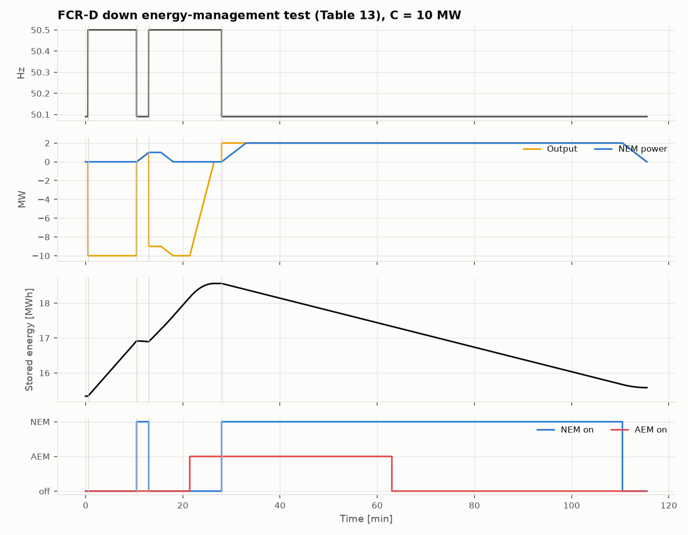

# Compliance report

Generated by `scripts/run_compliance.py` from `configs/base.yaml`. Do not edit by hand.

Requirements: *Technical Requirements for Frequency Containment Reserve Provision in the Nordic Synchronous Area*, version 1.1 (see docs/FCR_SPEC_NOTES.md).

**Unit under test.** Python BESS model: 10 MW / 20 MWh, usable window 5%-95%, converter time constant 0.2 s, per-product droop controllers with NEM and AEM.

**Tested capacities.** FCR-N 7.46 MW, FCR-D up 10 MW, FCR-D down 10 MW, each product tested alone from the target SOC.

**Result: 24 of 24 checks pass.**

| Requirement | Product | Measured | Threshold | Pass | Explanation |
|---|---|---|---|---|---|
| R1 up | FCR-N | 0.000 | [-0.05, 0.2] | PASS | dP_ss,1 = 7.460 MW: deviation +0.000 of \|dP_th\|, allowed [-0.05, +0.20] |
| R1 down | FCR-N | -0.000 | [-0.2, 0.05] | PASS | dP_ss,2 = -7.460 MW: deviation -0.000 of \|dP_th\|, allowed [-0.20, +0.05] |
| R1 | FCR-D up | -0.000 | [-0.05, 0.2] | PASS | P_ss,3 - P_ss,4 = 10.000 MW: deviation -0.000 of \|dP_th\|, allowed [-0.05, +0.20] |
| R2 | FCR-D up | 1.000 | >= 0.86 | PASS | dP(7.5 s) = 10.000 MW = 1.000 \|dP_th\| (need 0.86) |
| R2 hold | FCR-D up | 0.000 | <= 0.01 | PASS | largest drop below dP(7.5 s) before ramp 6: 0.0000 \|dP_th\| (small damped oscillations accepted; 1 % tolerance used) |
| R3 | FCR-D up | 6.512 s | >= 3.2 s | PASS | E(7.5 s) = 65.12 MWs = 6.51 s x \|dP_th\| (need 3.2 s) |
| R4 | FCR-D up | 1.156 s | <= 2.5 s | PASS | max excess energy after the nadir = 11.56 MWs = 1.16 s x \|dP_th\| |
| R1 | FCR-D down | 0.000 | [-0.2, 0.05] | PASS | P_ss,3 - P_ss,4 = -10.000 MW: deviation +0.000 of \|dP_th\|, allowed [-0.20, +0.05] |
| R2 | FCR-D down | 1.000 | >= 0.86 | PASS | dP(7.5 s) = 10.000 MW = 1.000 \|dP_th\| (need 0.86) |
| R2 hold | FCR-D down | 0.000 | <= 0.01 | PASS | largest drop below dP(7.5 s) before ramp 6: 0.0000 \|dP_th\| (small damped oscillations accepted; 1 % tolerance used) |
| R3 | FCR-D down | 6.512 s | >= 3.2 s | PASS | E(7.5 s) = 65.12 MWs = 6.51 s x \|dP_th\| (need 3.2 s) |
| R4 | FCR-D down | 1.156 s | <= 2.5 s | PASS | max excess energy after the nadir = 11.56 MWs = 1.16 s x \|dP_th\| |
| R8 | FCR-N | 2.190 | > 0.4085 (0.43 x 0.95) | PASS | min distance of G0 = F G to (-1, 0j): 2.190 |
| R9 | FCR-N | 0.500 | < 1 | PASS | max K_margin \|G/(1+FG)\| / \|1/D\| = 0.500 over the tested periods |
| R10 | FCR-N | 0.000 | < 1 | PASS | worst normalised RMS error of the fitted sine: 0.000 (T = 10 s) |
| R8 | FCR-D up | 1.538 | > 0.4085 (0.43 x 0.95) | PASS | min distance of G0 = F G to (-1, 0j): 1.538 |
| R9 | FCR-D up | 0.132 | < 1 | PASS | max K_margin \|G/(1+FG)\| / \|1/D\| = 0.132 over the tested periods |
| R10 | FCR-D up | 0.000 | < 1 | PASS | worst normalised RMS error of the fitted sine: 0.000 (T = 10 s) |
| R8 | FCR-D down | 1.538 | > 0.4085 (0.43 x 0.95) | PASS | min distance of G0 = F G to (-1, 0j): 1.538 |
| R9 | FCR-D down | 0.132 | < 1 | PASS | max K_margin \|G/(1+FG)\| / \|1/D\| = 0.132 over the tested periods |
| R10 | FCR-D down | 0.000 | < 1 | PASS | worst normalised RMS error of the fitted sine: 0.000 (T = 10 s) |
| R12 (LER) | FCR-N | 12.000 | 12 steps | PASS | 12/12 steps as Table 12 expects, 362 min test; no abrupt stop |
| R12 (LER) | FCR-D up | 5.000 | 5 steps | PASS | 5/5 steps as Table 13 expects, 126 min test; no abrupt stop |
| R12 (LER) | FCR-D down | 5.000 | 5 steps | PASS | 5/5 steps as Table 13 expects, 116 min test; no abrupt stop |

## Method notes

- Steady-state power P_ss is the mean over the last 60 s of each hold (the requirements do not fix the window).
- Requirements 2 and 3 use the power change from the start of ramp 5; Requirement 4 the change from the start of ramp 1, with the nadir 4.4 s after it.
- 'R2 hold' checks that the power does not drop below dP(7.5 s) before ramp 6; small damped oscillations are accepted, implemented as a 1 % of |dP_th| tolerance.
- Frequency domain: F(jw) from least-squares sine fits of the last stationary periods of each Table 6 test; G0 = F G with the Table 7 stability parameters (sign convention resolved in docs/FCR_SPEC_NOTES.md); Requirement 9 is checked on a log-spaced grid interpolated between the tested periods.
- The test signal is applied to the controller input directly, so no frequency measurement equipment transfer function (section 4.4) is included.
- LER tests (Tables 12-13) hold each step for its minimum duration and until its condition holds; they start 2 min of full activation before the NEM threshold, as section 3.5.3 allows to shorten the test.

## Figures

### FCR-N step response

### FCR-D up ramp response with the 7.5 s requirements

### FCR-D down ramp response with the 7.5 s requirements

### Nyquist stability (Requirement 8)

### Closed-loop performance (Requirement 9)

### FCR-N LER energy-management test (Requirement 12)

### FCR-D up LER energy-management test (Requirement 12)

### FCR-D down LER energy-management test (Requirement 12)

